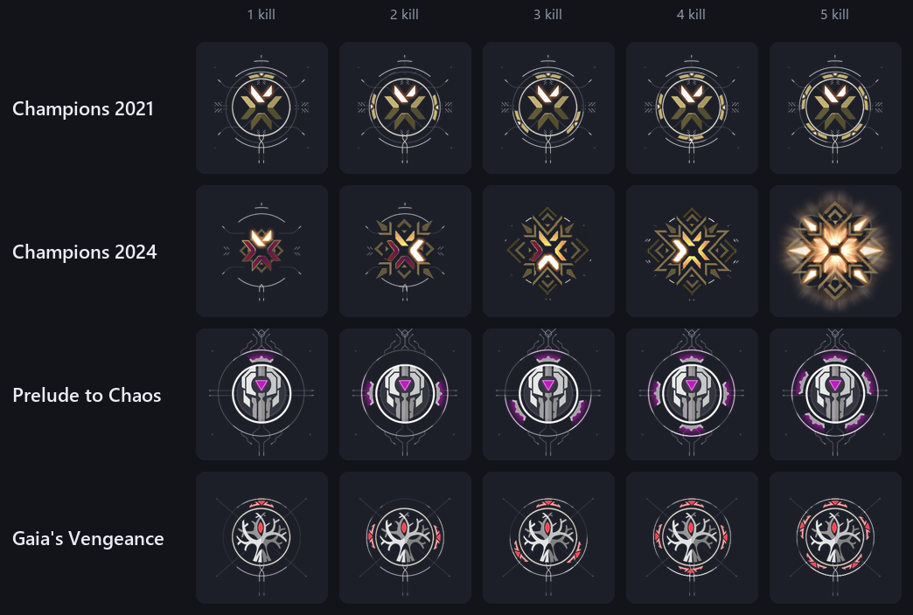
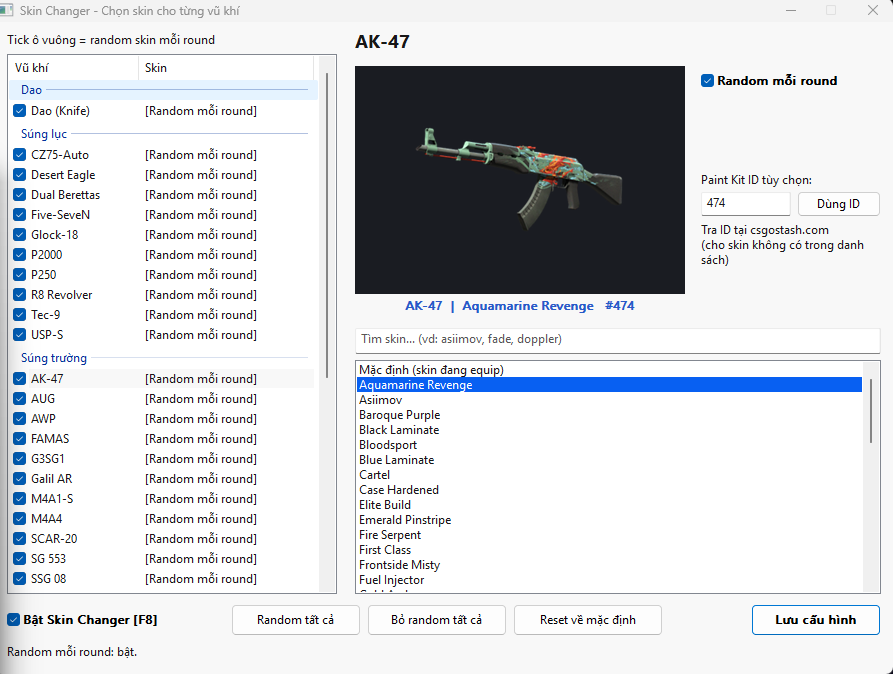
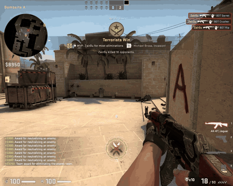
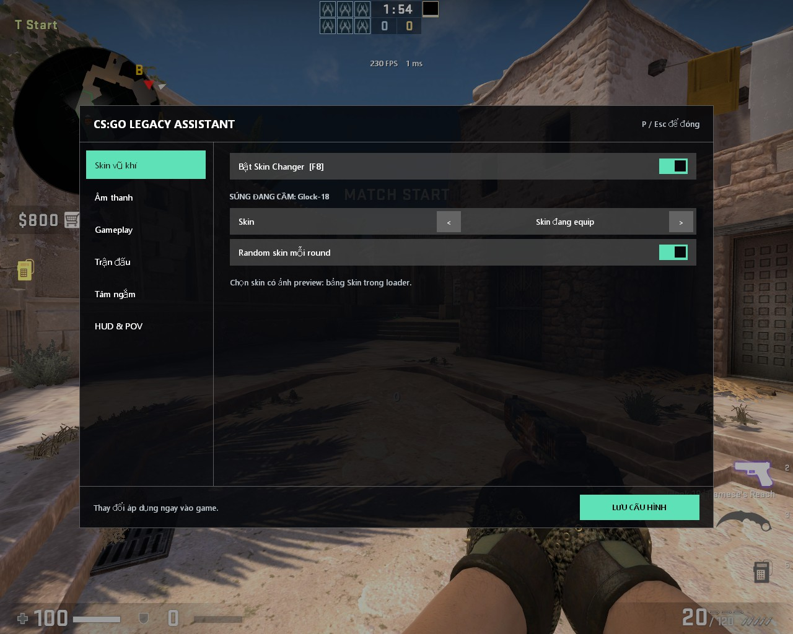
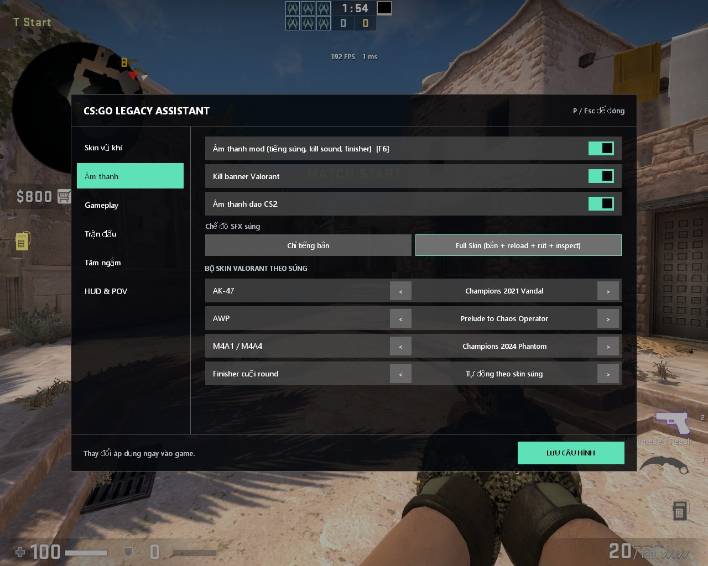
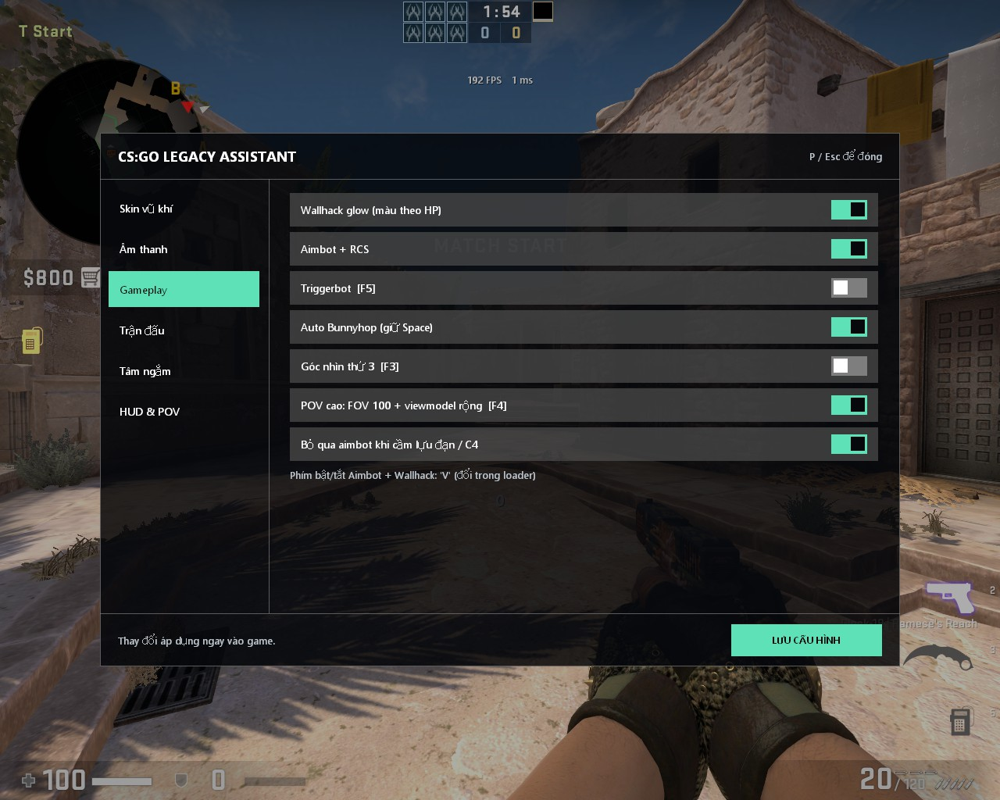
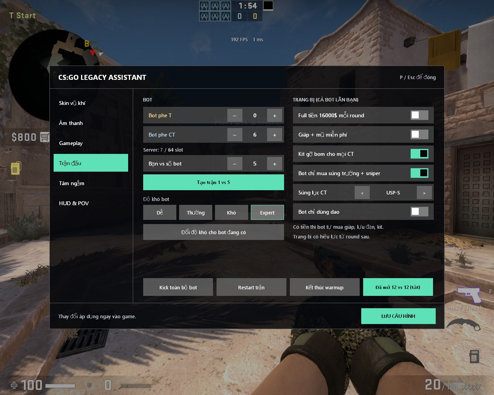
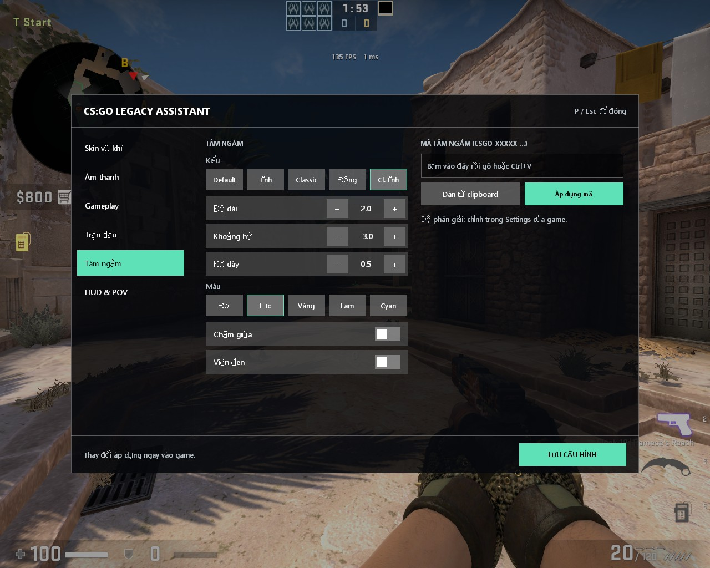
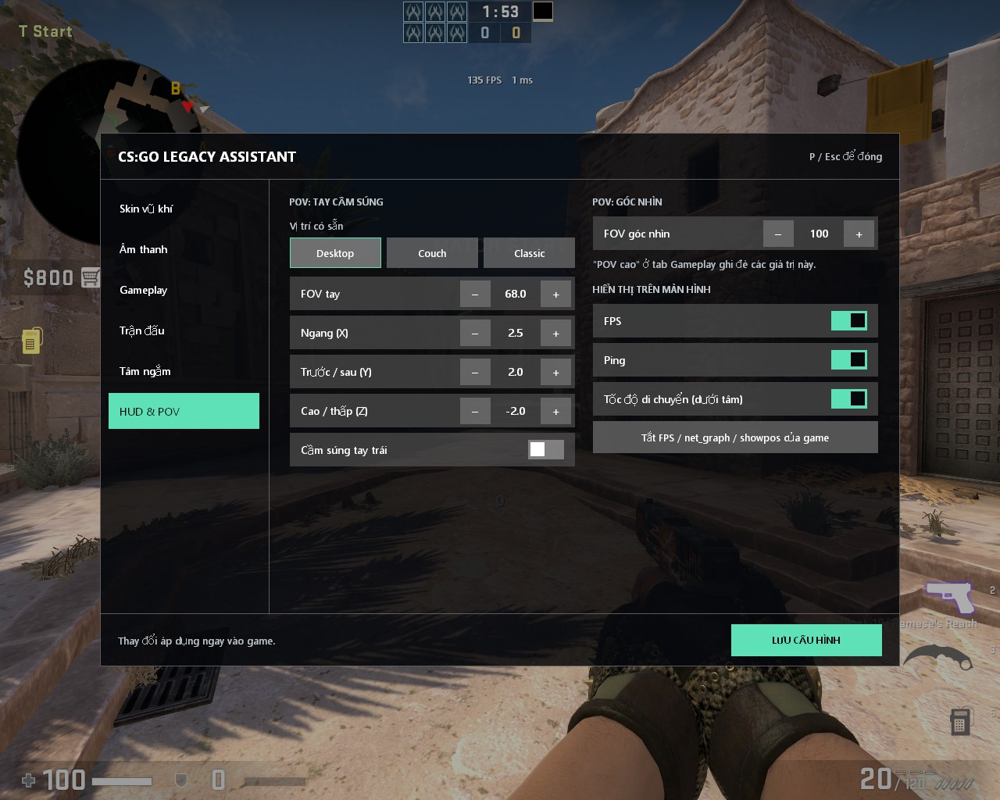
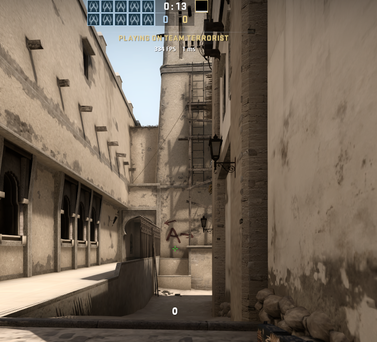

# CS:GO Legacy Assistant

**Mang trải nghiệm Valorant vào CS:GO offline: âm thanh skin, kill banner, finisher, skin changer cho mọi vũ khí và menu ngay trong game.**

-F7A31C)

### [⬇ Tải bản mới nhất](https://github.com/quynhtien1977/csgo-legacy-assistant/releases/latest)

> [!WARNING]
> Chỉ dùng cho **CS:GO offline (chơi với bot / server riêng)**. Inject DLL vào game trên server chính thức hoặc server có VAC vi phạm Điều khoản của Valve và có thể khiến tài khoản bị khoá vĩnh viễn. Bạn tự chịu trách nhiệm khi sử dụng.

Repo này chỉ chứa các bản phát hành để tải về.

## Tải về và cài đặt

Vào trang **[Releases](https://github.com/quynhtien1977/csgo-legacy-assistant/releases/latest)**, chọn một trong hai file:

| File | Dùng khi |
| --- | --- |
| `CSGO-Legacy-Assistant-Setup-<phiên bản>.exe` | Muốn cài như một ứng dụng: không cần quyền admin, cài vào `%LOCALAPPDATA%\CSGO Legacy Assistant`, có shortcut Start Menu (tuỳ chọn thêm Desktop) và gỡ được trong *Settings → Apps*. Cài bản mới đè lên bản cũ vẫn giữ thiết lập. |
| `CSGO-Legacy-Assistant-v<phiên bản>.zip` | Muốn bản portable: giải nén vào một thư mục bất kỳ, giữ nguyên các file và thư mục bên trong. |

**Yêu cầu:** Windows 10/11, CS:GO bản legacy **1.38.8.1**.

**Cách dùng:**

1. Mở CS:GO, vào trận với bot.
2. Mở **CSGO Legacy Assistant** (`loader.exe`), chỉnh thiết lập rồi bấm **START & INJECT CS:GO**. Nếu inject báo lỗi, chạy lại bằng quyền Administrator.
3. Trong game bấm **`P`** để mở menu; mọi thay đổi áp dụng ngay. Bấm **Lưu cấu hình** để giữ cho lần sau.

> [!NOTE]
> Windows SmartScreen hoặc antivirus có thể cảnh báo vì file chưa ký số và có chức năng inject DLL vào game. Nếu SmartScreen hiện "Windows protected your PC", bấm **More info → Run anyway**.

## Tính năng

### Bộ skin Valorant theo súng

| Súng | Bộ skin có sẵn |
| --- | --- |
| AK-47 | Champions 2021 Vandal, Gaia's Vengeance Vandal, Champions 2023 Vandal |
| AWP | Prelude to Chaos Operator |
| M4A1-S / M4A4 | Champions 2024 Phantom |

- **Tiếng súng**: chỉ tiếng bắn, hoặc trọn bộ (bắn, thay đạn, rút súng, inspect).
- **Kill sound 1–6** theo chuỗi kill trong round.
- **Kill banner** có animation (vòng đếm kill, particle, hiệu ứng headshot, Ace), tự đổi theo súng vừa hạ gục.
- **Finisher cuối round**: cố định hoặc tự động theo skin súng vừa kết liễu.

### Âm thanh dao + lựu đạn CS2

- Dao dùng âm thanh mới của CS2 theo đúng loại dao đang cầm (21 loại): rút dao, inspect, chém, đâm.
- Lựu đạn (flash, HE, smoke, molotov, incendiary, decoy): rút ra, rút chốt, ném tay trên / tay dưới như CS2.

### Skin Changer

- **34 súng, 1147 skin**, **19 loại dao với 35 finish**, chỉ gồm skin có trong CS:GO legacy.
- **Random mỗi round** cho từng vũ khí, dao random cả loại dao lẫn finish.
- Preview ảnh, tìm kiếm, áp dụng ngay vào game.

### Menu in-game (`P`)

| Tab | Nội dung |
| --- | --- |
| Skin vũ khí | Bật skin changer, đổi skin / random cho súng hoặc dao đang cầm |
| Âm thanh | Âm thanh mod, kill banner, âm thanh dao + lựu đạn CS2, bộ skin Valorant theo súng, finisher |
| Gameplay | Wallhack, aimbot + RCS, triggerbot, bunnyhop, góc nhìn thứ 3, POV cao |
| Trận đấu | Thêm/bớt bot từng phe, trận 1 vs N, độ khó bot, full tiền, giáp, kit, bot chỉ mua súng trường + sniper, CT dùng USP-S, mở khóa 12 vs 12 cho competitive |
| Tâm ngắm | Kiểu, độ dài, khoảng hở, độ dày, màu, chấm, viền, nhập / dán mã tâm ngắm |
| HUD & POV | Viewmodel, FOV, HUD riêng: FPS, ping, tốc độ di chuyển |

| | |
| --- | --- |
|  |  |
| Skin vũ khí | Âm thanh |
|  |  |
| Gameplay | Trận đấu |
|  |  |
| Tâm ngắm | HUD & POV |

*Trận 1 vs 12 bot (đã mở khóa 12 vs 12) với HUD của mod.*

## Phím tắt trong game

| Phím | Chức năng |
| --- | --- |
| `P` | Mở/đóng menu in-game (`Esc` cũng đóng) |
| `F3` | Góc nhìn thứ 3 |
| `F4` | POV cao |
| `F5` | Triggerbot |
| `F6` | Bật/tắt toàn bộ âm thanh mod |
| `F7` | Phát thử kill banner |
| `F8` | Skin changer |
| Phím toggle (mặc định `=`) | Aimbot + wallhack |
| `END` | Gỡ module khỏi game |

## Xử lý sự cố

| Triệu chứng | Cách xử lý |
| --- | --- |
| Inject báo lỗi | Chạy loader bằng quyền Administrator; cho phép file trong antivirus. |
| Game văng sau khi inject | Mở `module_log.txt` trong thư mục cài đặt và gửi kèm khi báo lỗi ở mục [Issues](https://github.com/quynhtien1977/csgo-legacy-assistant/issues). |
| Skin không đổi | Kiểm tra đã bật skin changer (`F8`). |

Lịch sử thay đổi của từng phiên bản nằm trong trang [Releases](https://github.com/quynhtien1977/csgo-legacy-assistant/releases).
